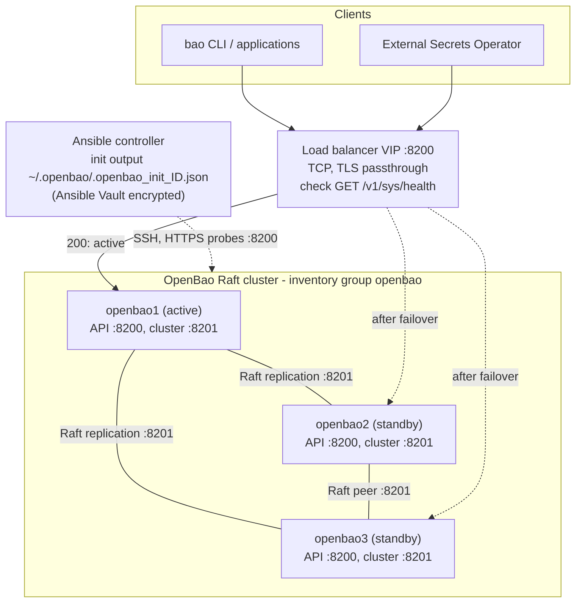
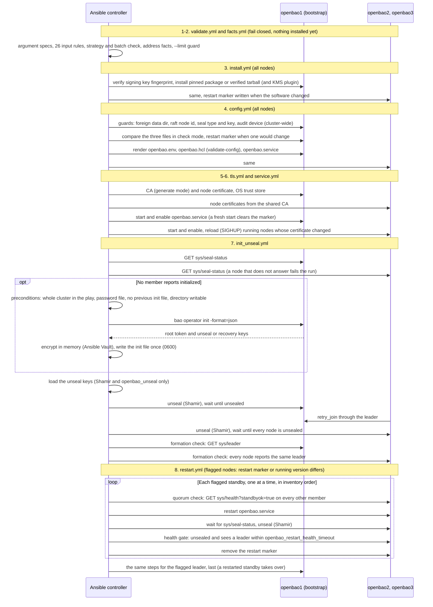

# Architecture

What the role builds, and how one run of the role moves through its stages.
Variable names link the pictures to [CONFIGURATION.md](CONFIGURATION.md).

---

## Raft HA topology

Three nodes are the recommended minimum: one active node and two standbys
that replicate through Raft integrated storage and keep quorum while one node
is down. Standbys can serve reads and forward writes to the active node. A load
balancer in front passes TLS through to the nodes and asks each node's
`sys/health` endpoint which one is active.

**Key design points:**

- `openbao_listen_address` and `openbao_cluster_listen_address` are the bind
  addresses (`0.0.0.0:8200`, `0.0.0.0:8201`); `openbao_api_addr` and
  `openbao_cluster_addr` are what each node advertises. They default to the
  node's default IPv4 address, so set them per host when that is not the
  address the other nodes and clients should use.
- Membership comes from `openbao_raft_peers` (default `groups['openbao']`):
  every node renders one `retry_join` block per other member, built from the
  members' `openbao_api_addr` or from `openbao_raft_retry_join_api_addrs`. The
  role refuses an inventory whose group name would split the hosts into
  one-node clusters.
- Each `retry_join` verifies the leader with `openbao_tls_ca_file` and the
  shared DNS SAN `openbao_tls_leader_servername`, so every node certificate
  carries that name. The role probes each node at its own `openbao_api_addr`,
  so the certificate also covers that host.
- Node identity is `openbao_raft_node_id` (default `inventory_hostname`) and
  never changes on a node with data; the role refuses the change.
- The controller holds the only copy of the init output written by the role.
  On Shamir clusters later runs read the unseal keys from it; the root token in
  the same file is never used by the role.
- Auto-unseal (`openbao_seal_type`: `static`, `transit`, `awskms`,
  `azurekeyvault`, `gcpckms`) adds an external dependency that every node needs
  at each start: the unsealer cluster or the cloud KMS. The cloud seals run as
  KMS plugin processes from `openbao_plugin_dir`.
- Audit is a declarative file device in `openbao.hcl`, identical on every node
  and present before the first start; logrotate reloads OpenBao so the device
  reopens its file.

---

## One run of the role

`tasks/main.yml` only orchestrates. Every stage is its own task file with its
own tag; the whole cluster group runs in one play with the default linear
strategy and no `serial` (`facts.yml` refuses both). The rolling behaviour is
inside the role. The API stages (7 and 8) aggregate over the started members
only: a member with `openbao_service_state: stopped` is neither probed nor
restarted, counts as missing for init, and fails the quorum check of every
restart.

| Step | Task file | Tag | Runs when |
|---|---|---|---|
| 1 | `validate.yml` | `always` | every run |
| 2 | `facts.yml` | `always` | every run |
| 3 | `install.yml` | `install` | not `openbao_config_only` |
| 4 | `config.yml` | `config` | every run (guards not in config-only mode) |
| 5 | `tls.yml` | `tls` | every run (inner gates) |
| 6 | `service.yml`, then flush handlers | `service` | not `openbao_config_only` |
| 7 | `init_unseal.yml` | `init_unseal` | not config-only and `openbao_service_state: started` |
| 8 | `restart.yml` | `restart` | not config-only and `openbao_service_state: started` |

**Notes:**

- Cluster state comes only from the unauthenticated HTTP API
  (`sys/seal-status`, `sys/leader`, `sys/health`) through `uri` with the CA in
  `openbao_tls_ca_file`. The CLI runs only for `operator init`, with `BAO_ADDR`
  and `BAO_CACERT`; the role never sets `BAO_TOKEN` and never uses the root
  token, so revoking it after bootstrap does not break later runs.
- Init runs only when every member answered "not initialized" and the whole
  cluster is in the play (`openbao_init`). The init output is encrypted before
  it touches the controller disk (`openbao_init_encrypt_output`,
  `openbao_init_encrypt_password_file`) and is never overwritten.
- Restart intent is persistent: a pending change of `openbao.hcl`,
  `openbao.env` or the unit writes `<openbao_config_dir>/.ansible-restart-pending`
  on that node before the file is written (a check-mode comparison runs
  first), and a package, binary or plugin change right after the install. A
  run that stops before step 8, even between a render and the next task,
  leaves the marker, and the next run restarts the node. A running version
  other than `openbao_version` flags a node too.
- Before each restart every other member must answer `sys/health` as active or
  standby; after it the node must be unsealed and see a leader. A failed check
  stops the play with quorum intact. The leader goes last, so leadership moves
  once per rolling restart. With Shamir and `openbao_unseal: true` nothing is
  restarted while the unseal keys cannot be read from the init file.
- Certificate changes reload (SIGHUP) the nodes that were already running
  before this run; they are never restarted for a certificate. A node stopped
  with `openbao_service_state: stopped` stays stopped. A reload is more than a
  certificate reload: OpenBao re-reads `openbao.hcl` and applies the log
  level, declarative audit device additions and removals (on the active node)
  and KMS plugin stanzas (a changed plugin is respawned) at once, and the
  nightly logrotate reload does the same on every node. So a rendered config
  is partly live before its rolling restart; storage, listener addresses,
  seal and environment changes wait for the restart.
- `--check --diff` on converged hosts reports pending file and package changes
  and the nodes that would be restarted (including those whose files would
  change in this run); it never initializes, unseals, restarts or reloads
  anything.
